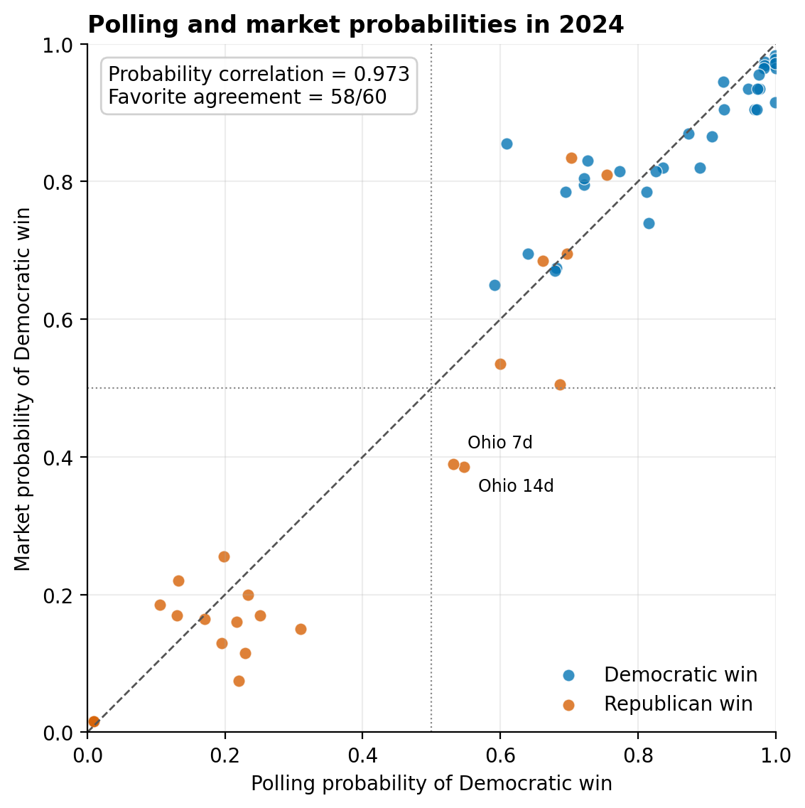
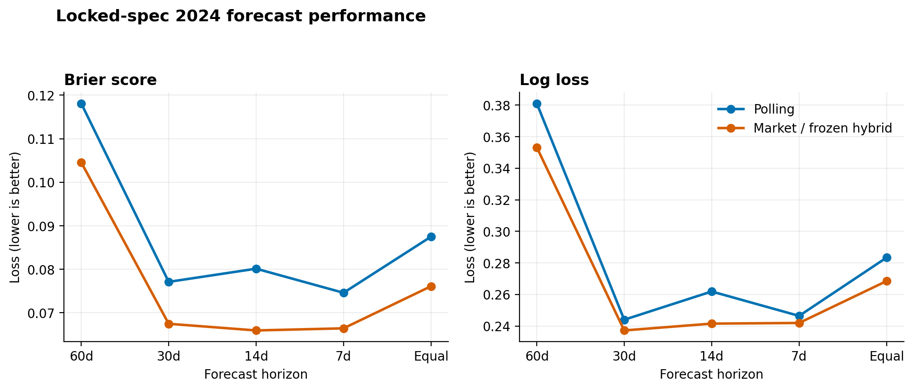
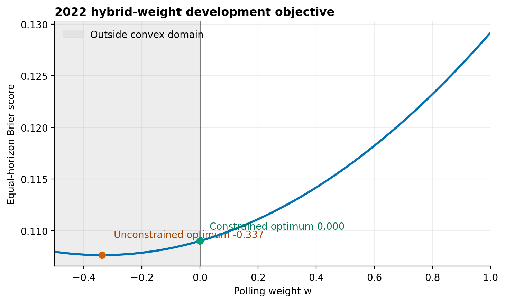

# Senate Polling vs. Prediction Markets

[](https://github.com/sebastian-tomass/senate-polling-prediction-markets/actions/workflows/ci.yml)
[](LICENSE)

**Question:** Can polling and prediction markets be meaningfully combined to improve U.S. Senate election forecasts?

**What I built:** An end-to-end forecasting pipeline that reconstructs a quality-weighted polling model, aligns it with prediction-market probabilities at four pre-election horizons, learns a simple ensemble on 2022 races, and evaluates the frozen rule on 2024 races.

**Headline result:** In the simple convex ensemble tested here, **no**. The 2022 development fit assigned zero positive weight to polling. Prediction markets then had lower 2024 point-estimate Brier score and log loss, although uncertainty across 18 races was too large to establish a precise market advantage.

**Why it matters:** Polling and market forecasts were highly associated—0.973 probability correlation and agreement on the favored party in 58 of 60 observations. In this setting, combining two forecasts that largely contained the same signal did not improve predictive performance.

**Reproduce the complete analysis:**

```bash
python src/run_pipeline.py
```

The command deterministically rebuilds calibration, polling forecasts, the 2022 hybrid fit, 2024 scores, clustered bootstrap intervals, tables, and figures. Install the two pinned dependencies first with `python -m pip install -r requirements.txt`.

## Results at a glance

The ensemble is

```text
p_hybrid = w * p_poll + (1 - w) * p_market
```

The unconstrained 2022 estimate was `w = -0.337`; imposing the prespecified convex bound `0 <= w <= 1` put the fitted weight at **w = 0**. The frozen hybrid therefore equals the market forecast.

| 2024 equal-horizon score | Polling | Market / frozen hybrid | Poll − market |
| --- | ---: | ---: | ---: |
| Brier score | 0.087484 | **0.076103** | +0.011381 |
| Log loss | 0.283330 | **0.268463** | +0.014867 |

Positive differences favor the market. Whole-race clustered 95% bootstrap intervals include zero for both Brier score `[-0.011233, 0.035584]` and log loss `[-0.043708, 0.072087]`, so the size and sign of the aggregate advantage remain imprecise.

## What the forecasts contained



The 45-degree line shows how closely the two forecast sources tracked one another. Their probability correlation was **0.973**; most differences concern confidence in the same likely winner rather than which party was favored.

## Performance by horizon



Market probabilities had lower point-estimate Brier score and log loss at each of the four evaluation horizons. This is descriptive evidence from a retrospective 18-race sample, not a claim of a precisely estimated universal advantage.

## Why the fitted ensemble became market-only



The unconstrained objective continued improving below zero polling weight. Because the model was deliberately restricted to a convex combination, its constrained optimum lay at the boundary: **w = 0**.

## Study design

| Stage | Role |
| --- | --- |
| 2006–2020 | Calibrate horizon-specific polling error distributions |
| 2022 | Fit one global poll/market ensemble weight |
| 2024 | Evaluate the already-frozen combination rule retrospectively |
| 2026 | Planned prospective test of the finalized specification |

Forecasts are evaluated at 60, 30, 14, and 7 days before Election Day. The polling pipeline uses recency, sample size, repeat-pollster dilution, vintage-safe pollster reliability, and historical Senate polling-error calibration. Market observations are independently reconstructed from checksum-pinned archives.

## Reproduction and audit trail

```bash
python -m pip install -r requirements.txt
python src/run_pipeline.py
python -m unittest discover -s tests -v
```

The default pipeline is deterministic and offline. To reacquire and normalize the checksum-pinned market archives as part of the run:

```bash
python src/run_pipeline.py --rebuild-markets
```

GitHub Actions compiles the source, runs the full test suite, executes the end-to-end pipeline, and uploads the generated tables and figures on every push and pull request.

Technical documentation:

- [Full methodology](docs/methodology.md)
- [Results, uncertainty, and output inventory](docs/results.md)
- [Data sources and provenance](docs/data_sources.md)
- [Processed-data lineage](data/processed/README.md)
- [Source-module guide](src/README.md)

## Interpretation

> **In the simple convex ensemble tested here, polling and market probabilities could not be meaningfully combined to improve Senate forecasts.** They were highly associated, and the 2022 development fit assigned zero positive weight to polling. Markets subsequently had lower 2024 point-estimate probabilistic losses, but uncertainty across 18 races was too large to establish a precise market advantage.

This conclusion is intentionally narrow. The project does **not** show that polling is useless, that markets always outperform polls, or that market prices contain no polling information. The 2024 evaluation is retrospective; the planned 2026 application is the prospective test.

## License

Code and documentation are released under the [MIT License](LICENSE). Third-party source data remain subject to their original providers' terms and are not redistributed here.
